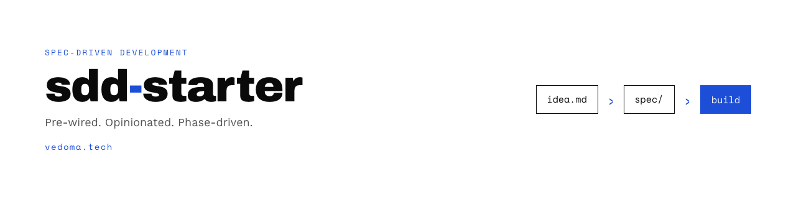
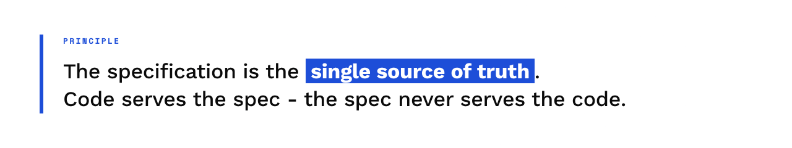
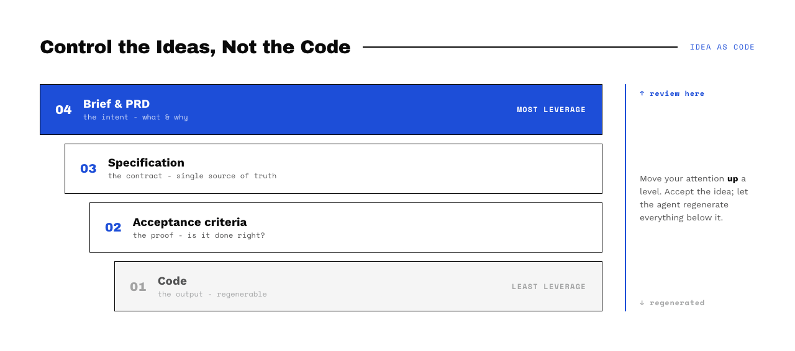
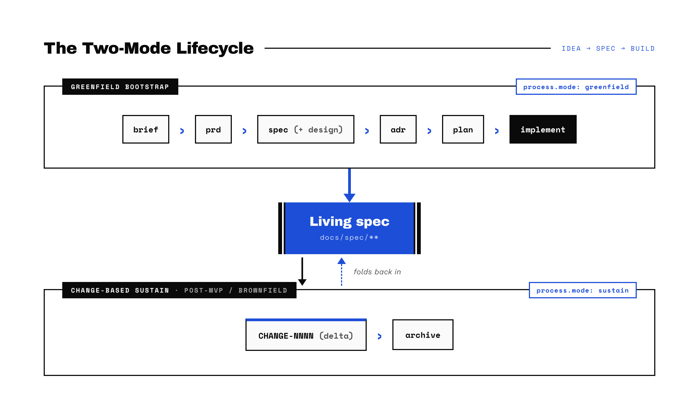
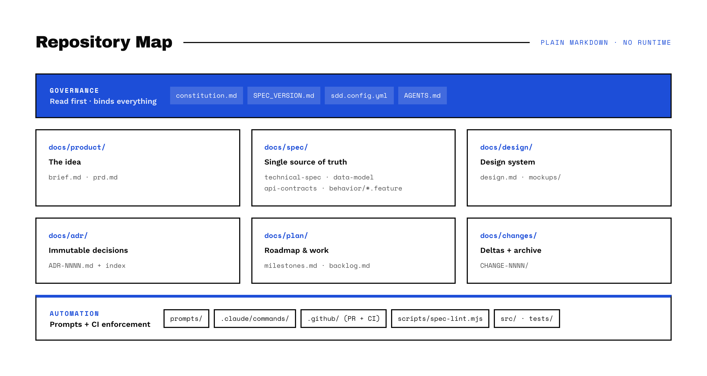
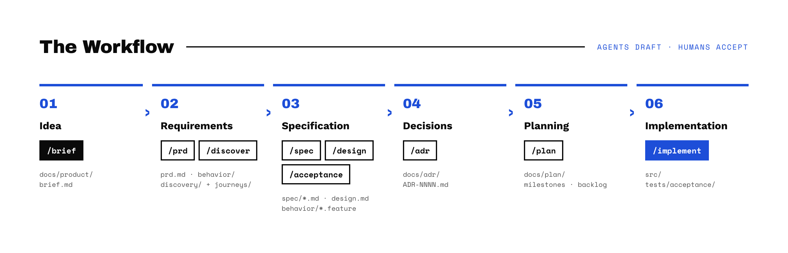
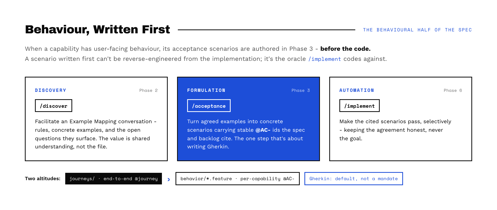
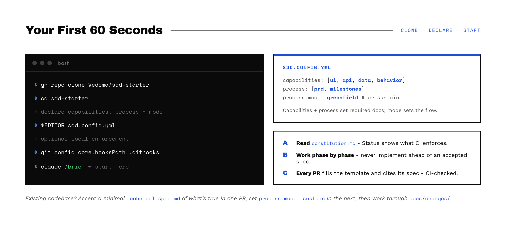
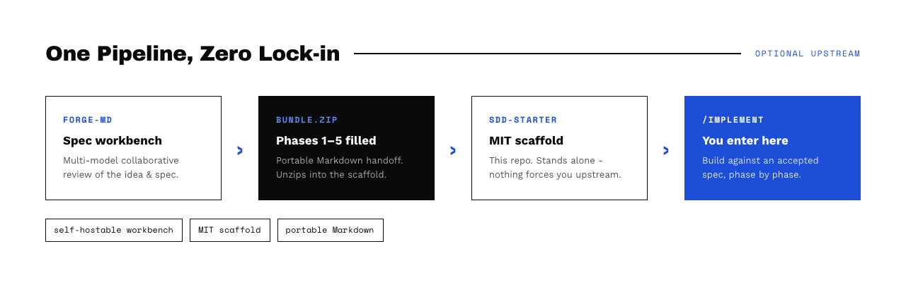
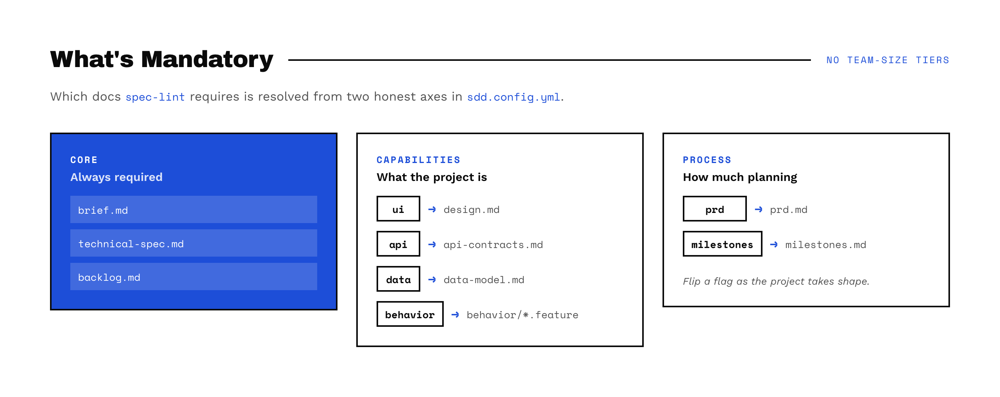

<picture>
  <source media="(prefers-color-scheme: dark)" srcset="./.github/assets/readme-banner-dark.png">
  
</picture>

# SDD Starter - Spec-Driven Development Scaffold

<picture>
  <source media="(prefers-color-scheme: dark)" srcset="./.github/assets/principle-dark.png">
  
</picture>

A ready-to-use, MIT-licensed scaffold for **Spec-Driven Development**: plain Markdown,
no CLI, no runtime, no lock-in. Clone it, declare what you're building, and drive a project
from idea to implementation with every decision traceable, and every rule saying how - and
whether - it is enforced.

## Why This Exists - Control the Ideas, Not the Code

When an LLM can generate more code than you can read, reviewing code line-by-line stops
scaling. The leverage moves **up a level** - to the ideas the code must satisfy: the
brief, the spec, the decisions, the acceptance criteria. That is not the end of software
craftsmanship; it is craftsmanship applied where it now counts. (See antirez,
[_Control the ideas, not the code_](https://antirez.com/news/169).)

<picture>
  <source media="(prefers-color-scheme: dark)" srcset="./.github/assets/leverage-dark.png">
  
</picture>

This scaffold makes those ideas first-class: **versioned, reviewable, and enforced** with
the same rigor as code - immutable decisions, an amendment process, and CI gates that
block a non-compliant PR rather than trusting an agent to remember the rules. That is what
"Idea as code" means here.

## The Two-Mode Lifecycle

<picture>
  <source media="(prefers-color-scheme: dark)" srcset="./.github/assets/lifecycle-dark.png">
  
</picture>

- **Greenfield** builds the initial living spec, phase by phase.
- **Change-based** sustains it: after the spec is accepted you never edit it ad hoc -
  every change is a delta (`ADDED` / `MODIFIED` / `REMOVED`) in `docs/changes/CHANGE-NNNN/`,
  registered in the Change Registry, that folds into the living spec and is then archived.
  Archiving keeps an agent's working context small (it reads the active tree, not the
  history) without losing the audit trail. See [`docs/changes/`](./docs/changes/).

A project is in exactly one mode, declared as `process.mode` (`greenfield` | `sustain`) in
[`sdd.config.yml`](./sdd.config.yml), and `spec-lint` holds it there: no change directories
under `greenfield`; under `sustain` the spec must be accepted, and it changes only in the
pull request that delivers a change - folding the delta in, bumping
[`SPEC_VERSION.md`](./SPEC_VERSION.md) and archiving the change.

## Repository Structure

<picture>
  <source media="(prefers-color-scheme: dark)" srcset="./.github/assets/repomap-dark.png">
  
</picture>

```
.
├── constitution.md               ← binding principles + enforcement Status (read first)
├── SPEC_VERSION.md               ← spec version + amendment log
├── sdd.config.yml                ← capabilities + process (which docs are mandatory)
├── AGENTS.md                     ← operating manual (the single source every tool loads)
├── CLAUDE.md                     ← imports constitution + AGENTS for Claude Code
├── GEMINI.md                     ← imports constitution + AGENTS for Gemini CLI
├── docs/
│   ├── product/                  ← brief.md, prd.md
│   ├── spec/                     ← technical-spec.md (SSoT), data-model.md, api-contracts.md
│   │   └── behavior/             ← *.feature acceptance spec + journeys/ + discovery/ (behaviour)
│   ├── design/                   ← design.md (design system) + mockups/
│   ├── adr/                      ← MADR decisions (ADR-0000-template.md) + index
│   ├── plan/                     ← milestones.md, backlog.md (+ archive/)
│   ├── changes/                  ← CHANGE-NNNN deltas (+ archive/)
│   ├── repo-setup.md             ← the GitHub settings the constitution assumes
│   ├── profiles.md               ← what capabilities/process resolve to
│   └── ecosystem/                ← OPTIONAL: forge-md interop (delete if unused)
├── prompts/                      ← tool-agnostic prompt body per command
├── .claude/commands/             ← Claude Code command wrappers over prompts/
├── .cursor/rules/                ← points Cursor at AGENTS.md + constitution
├── .githooks/                    ← optional pre-commit hook that runs spec-lint
├── .github/
│   ├── assets/                   ← the README's images (light + dark)
│   ├── copilot-instructions.md   ← points Copilot at AGENTS.md + constitution
│   ├── CODEOWNERS                ← required reviewers (fill in before enabling)
│   ├── PULL_REQUEST_TEMPLATE.md
│   └── workflows/                ← spec-lint, adr-status, create-followup; inactive
│                                   templates a11y.yml.example, acceptance-tests.yml.example
├── scripts/spec-lint.mjs         ← the enforcement backbone
├── src/                          ← implementation
├── tests/                        ← acceptance/ (runs the .feature scenarios), integration/, unit/
│                                   (integration/spec-lint-*: the scaffold's own tests)
└── LICENSE                       ← MIT
```

## The Workflow

<picture>
  <source media="(prefers-color-scheme: dark)" srcset="./.github/assets/workflow-dark.png">
  
</picture>

Each phase has a command (Claude Code: [`.claude/commands/`](./.claude/commands/)) backed
by a tool-agnostic prompt (any agent: [`prompts/`](./prompts/)):

| # | Phase | Command | Output |
|---|-------|---------|--------|
| 1 | Idea | `/brief` | `docs/product/brief.md` |
| 2 | Requirements | `/prd`, `/discover` | `docs/product/prd.md`, `docs/spec/behavior/discovery/*.md`, `docs/spec/behavior/journeys/*.feature` |
| 3 | Specification | `/spec`, `/design`, `/acceptance` | `docs/spec/*.md`, `docs/design/design.md`, `docs/spec/behavior/*.feature` |
| 4 | Decisions | `/adr` | `docs/adr/ADR-NNNN-*.md` |
| 5 | Planning | `/plan` | `docs/plan/milestones.md`, `docs/plan/backlog.md` |
| 6 | Implementation | `/implement TASK-XXX` | `src/`, `tests/` |

Outside the phases: `/change` and `/amend` drive change-based mode, and `/pr-review` is the
review standard for every pull request - the agent drafts the review, a human decides.

Agents draft; humans accept. Every generated document marks inferences
`[INFERRED - CONFIRM]` and gaps `[OPEN - REQUIRES INPUT]` rather than guessing, and keeps
the scaffold's section headings verbatim, even when the content is in another language. See
[`AGENTS.md`](./AGENTS.md).

## Behaviour, Specified Before It's Built

<picture>
  <source media="(prefers-color-scheme: dark)" srcset="./.github/assets/behavior-dark.png">
  
</picture>

When a capability has user-facing behaviour (`capabilities.behavior: true`), the scaffold
captures it as **executable acceptance scenarios authored in Phase 3, before the code** - the
behavioural half of the spec ([`docs/spec/behavior/`](./docs/spec/behavior/)). This is
constitution **C10**, and it is how C5 ("tests derive from acceptance criteria") stops being
an honour system: a scenario written before the implementation cannot be reverse-engineered
from it. A defining example a human already accepted is also the highest-leverage instruction
you can hand a coding agent - the oracle `/implement` codes against, and the thing you review
*instead of* the diff.

Behaviour is worked as **three practices**, and only the middle one is about writing Gherkin:

- **Discovery** (`/discover`, Phase 2) - facilitate an Example Mapping conversation: rules,
  concrete examples, and the open questions they surface. The value is the shared
  understanding, not the file.
- **Formulation** (`/acceptance`, Phase 3) - turn the agreed examples into concrete scenarios
  carrying stable `@AC-` ids that the spec and backlog tasks cite. Traceability flows outward
  from the scenario; a dangling citation fails `spec-lint`.
- **Automation** (`/implement`, Phase 6) - make the cited scenarios pass, **selectively**.
  Automation is a by-product that keeps the agreement honest, not the goal.

Two altitudes keep it from sprawling: product-level **journeys**
([`docs/spec/behavior/journeys/`](./docs/spec/behavior/journeys/), a few end-to-end `@journey`
happy paths) sit thinly above the per-capability **feature** scenarios. The Gherkin writing
rules are a vendored, pluggable contract
([`gherkin-guidelines.md`](./docs/spec/behavior/gherkin-guidelines.md)) - Gherkin is the
**default, not a mandate**. It is all optional and light: turn it on when it earns its keep,
and `spec-lint` then requires a real, `@AC-`traced scenario and checks that every id a task
cites resolves to one.

## Getting Started

<picture>
  <source media="(prefers-color-scheme: dark)" srcset="./.github/assets/quickstart-dark.png">
  
</picture>

1. **Clone and rename** this repo.
2. **Declare your project** in [`sdd.config.yml`](./sdd.config.yml) - set `capabilities`
   (`ui` / `api` / `data` / `behavior`) and `process` (`prd` / `milestones`), which decide
   which docs are mandatory, and `process.mode` (`greenfield` for a new project).
3. **Read [`constitution.md`](./constitution.md)** - the binding rules. Check the `Status`
   column: it says which clauses a machine actually blocks and which are review-only or
   not yet enforced at all. Do not assume a rule is checked because it is written down.
4. **Do the setup in [`docs/repo-setup.md`](./docs/repo-setup.md)** - required status
   checks, branch protection, CODEOWNERS. Until that is done the check runs but nothing
   *blocks* a merge, and C8 is not enforced at all.
5. **Enable the local hook** (optional): `git config core.hooksPath .githooks`.
6. **Start at `/brief`**. For an existing codebase, write a minimal
   `docs/spec/technical-spec.md` of what is already true and accept it in one pull request,
   then switch `process.mode` to `sustain` in a second and drive changes through
   `docs/changes/` ([`docs/changes/README.md`](./docs/changes/README.md)).
7. **Work phase by phase** - do not implement ahead of an accepted spec. Every PR fills
   [`.github/PULL_REQUEST_TEMPLATE.md`](./.github/PULL_REQUEST_TEMPLATE.md), and CI checks
   its structure too - `gh pr create --body` skips GitHub's template injection, so copy it.

## Landing Zone for a forge-md Bundle

<picture>
    <source media="(prefers-color-scheme: dark)" srcset="./.github/assets/forgemd-dark.png">
    
</picture>

This scaffold is the downstream half of a pipeline. The
[**forge-md**](https://github.com/Vedoma/forge-md) workbench takes an idea through
collaborative, multi-model spec review and exports a **bundle** that unzips straight into
this structure - phases 1–5 already filled (brief, PRD, spec, decisions, plan). You then
enter at `/implement`. The mapping is described in the optional
[`docs/ecosystem/forge-md.md`](./docs/ecosystem/forge-md.md) (delete it if you never use
forge-md).

Nothing forces you upstream: this scaffold stands alone. Together they are one pipeline -
collaborative spec review + a neutral public scaffold + a plain-Markdown handoff - with
**zero lock-in at every layer**: self-hostable workbench, MIT scaffold, portable Markdown.

## What CI Actually Checks

[`scripts/spec-lint.mjs`](./scripts/spec-lint.mjs) runs on every pull request on stock Node,
with no dependencies. Once your technical spec is filled in, it fails the PR when:

- a required document is missing, keeps a scaffold placeholder (`[Product Name]`,
  `YYYY-MM-DD`, ...), or renames, re-cases or drops one of the scaffold's section headings;
- a task or the PR has no Spec Reference, or one that does not resolve - a `§N` must be a
  real section of the technical spec, a `CHANGE-NNNN` a real change;
- the PR body drops a heading of the PR template or keeps one of its placeholders;
- the process mode is broken: the wrong artifacts for the mode, a spec edited outside a
  delivered change, the spec's two version records disagreeing, or a change deleted rather
  than archived;
- an ADR is still `proposed`, or the decision and change registries disagree with their files.

Each finding names the constitution clause it enforces. `spec-lint` tests itself too:
`node --test tests/integration/spec-lint-*.test.mjs`, run by the same workflow. What it
*cannot* check - whether the spec a PR cites really covers the work, whether an ADR's body
was edited after acceptance - is listed clause by clause in the `Status` column of
[`constitution.md`](./constitution.md).

## Key Rules

The binding principles live in **[`constitution.md`](./constitution.md)** - each with the
CI/review mechanism that enforces it. In short: the spec is the single source of truth;
spec overreach is a defect; accepted specs are never edited silently (use the
`SPEC_VERSION.md` amendment process); ADRs are immutable (supersede, never overwrite);
tests derive from acceptance criteria; behaviour is specified before it's built (C10); no
secrets in the repo; every change is reviewable and reversible. Read the constitution for
the full, enforceable list.

## Choosing What's Mandatory

<picture>
    <source media="(prefers-color-scheme: dark)" srcset="./.github/assets/mandatory-dark.png">
    
</picture>

No team-size tiers. Which documents are required is a real, machine-read setting driven by
two honest axes in [`sdd.config.yml`](./sdd.config.yml): **capabilities** - what the project
is (`ui` → design spec, `api` → api-contracts, `data` → data-model, `behavior` → acceptance
scenarios) - and **process** - how much planning you want (`prd`, `milestones`). The core
(brief, technical-spec, backlog) is always required; `spec-lint` enforces exactly what the
config resolves to. A data-less CLI is never asked for a data model; a solo UI app still gets
its design spec. See [`docs/profiles.md`](./docs/profiles.md) for the model and starting points.

## License

<picture>
  <source media="(prefers-color-scheme: dark)" srcset="./.github/assets/license-dark.png">
  
</picture>

MIT. Use it freely for commercial and open-source projects.
